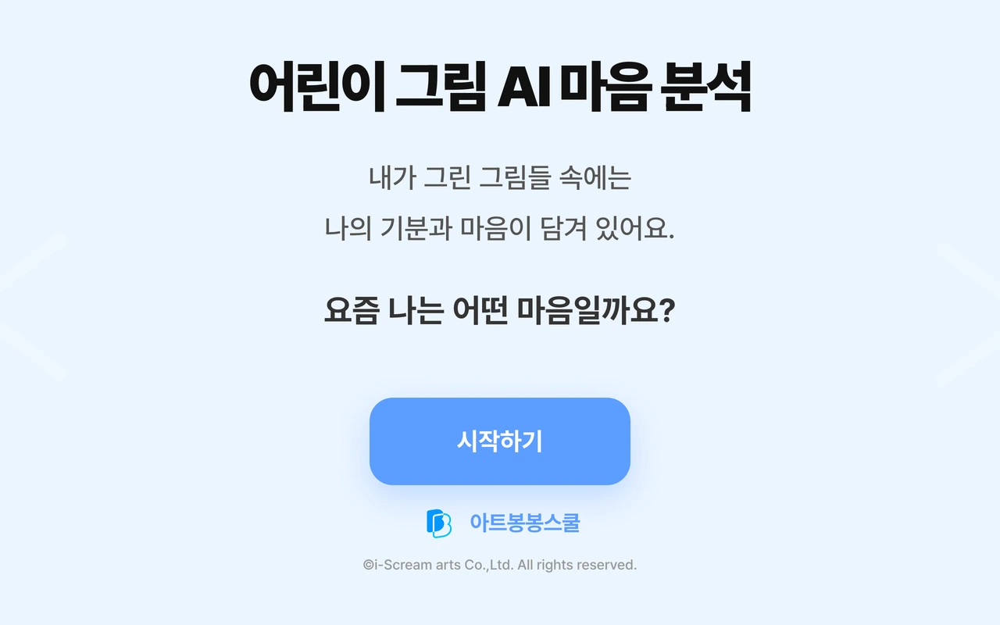

# 어린이 그림 AI 마음분석

아이의 그림을 올리고 캐릭터를 고르면 색·구도·분위기를 분석해 캐릭터 말투로 감상평을 들려주는 콘텐츠.

**데모:** https://maum-drawing-ai.vercel.app



## 내 역할

기획·디자인·프론트엔드·백엔드·배포 1인 담당 (Claude Code 등 AI 코딩·생성 도구 활용)

## 기술 스택

- Next.js · React · TypeScript · Tailwind CSS
- Next.js API Route
- Google Gemini 2.5 Flash
- Supabase (PostgreSQL)

## 데이터베이스

Supabase의 `drawing_ai` 스키마를 사용합니다. 테이블은 `supabase/migrations/`, 데모용 더미 데이터는 `supabase/seed.sql`에 있습니다. 스키마 이름과 접속 정보는 모두 환경변수로 받습니다.

## 로컬 실행

```bash
cd frontend
cp .env.example .env.local   # 값 입력
npm install
npm run dev
```

`backend/`는 Next.js API Route로 옮기기 전의 FastAPI 원본입니다.

## 에셋 출처

캐릭터는 회사 제공 에셋 사용. 그 외 에셋은 직접 제작.

---

아이스크림아트 재직 중(2025.11~2026.11) 제작. 회사 로고·'아트봉봉스쿨' 등 브랜드명과 회사 제공 캐릭터의 권리는 아이스크림아트에 있음.
